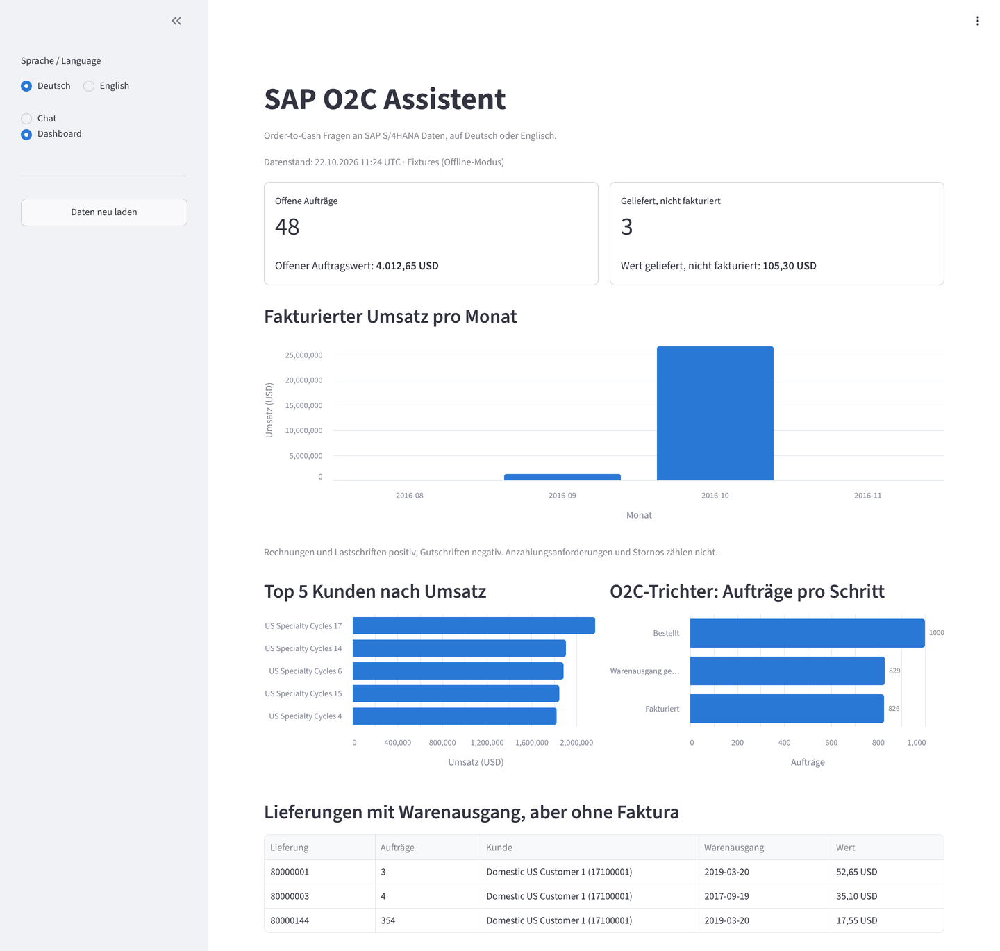
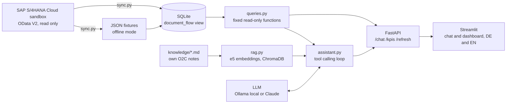

# SAP O2C Assistant


A chat assistant and KPI dashboard for the SAP S/4HANA Order-to-Cash process. Ask in German or English, for example "Which orders are delivered but not billed yet?" The assistant answers from real SAP sandbox data, names the documents behind every answer and explains the O2C step.



## The problem

A sales back office loses time on simple status questions. Where is order 48? What is still open for this customer? Which deliveries left the warehouse but have no invoice yet? In SAP the answer is spread over VA03, VL03N, VF03 and the document flow. Each question means several screens.

## The solution

1. A sync job loads sales orders, deliveries, billing documents and business partners from the SAP S/4HANA Cloud sandbox APIs into SQLite. Read only.
2. An LLM answers questions with tool calling. It never writes SQL. It can only call fixed, tested Python functions.
3. RAG over my own O2C process notes explains terms and reasons, for example why a delivery stays unbilled.
4. A dashboard shows open orders, delivered but not billed, revenue per month, top customers and the O2C funnel.
5. Runs free and offline: a local model through Ollama, fixtures instead of the API. Claude is supported as a second provider.

## Example answer

A real answer from the evaluation run, unedited. Local model qwen3:4b-instruct, 25 seconds, one tool call: `get_delivered_not_billed`.

**Question:** Welche Aufträge sind geliefert, aber nicht fakturiert?

> Es gibt 3 Lieferungen, die geliefert aber nicht fakturiert sind, insgesamt mit einem Wert von 105,30 USD.
>
> - **Lieferung 80000001**: Kunden "Domestic US Customer 1" (Kundennummer 17100001), Wert 52,65 USD, Auftrag 3
> - **Lieferung 80000003**: Kunden "Domestic US Customer 1" (Kundennummer 17100001), Wert 35,10 USD, Auftrag 4
> - **Lieferung 80000144**: Kunden "Domestic US Customer 1" (Kundennummer 17100001), Wert 17,55 USD, Auftrag 354
>
> **Prozessschritt**: Diese Fälle liegen im Schritt "Lieferung" (Delivery), bei dem die Waren ausgeliefert wurden, aber noch keine Fakturierung erfolgt ist. Die Fakturierung ist noch nicht abgeschlossen, was zu einem offenen Billing-Status führt.
>
> *Datensatz aus dem SAP S/4HANA Cloud Sandbox, bis zu 1000 Zeilen pro Tabelle, alle Beträge in USD.*

All 15 answers are in [eval/results.json](eval/results.json).

## Architecture



## Design decisions

1. **Tools, not free SQL.** The model picks one of seven functions and passes parameters. The dict of tools is the whole permission system. Parameters go in as bound values, so an input like `1' OR '1'='1` stays harmless. A test proves it.
2. **Links on item level.** Delivery and billing headers carry no order number. The link sits on the items, like in SAP. A view `document_flow` joins order item, delivery and invoice, so one delivery can cover several orders.
3. **Billing status from the delivery.** The order header status `OverallOrdReltdBillgStatus` only covers order related billing. For goods the billing status sits on the delivery (`OverallDelivReltdBillgStatus`). I found this in the real data: all delivered orders showed an empty billing status on the header.
4. **Revenue follows SAP billing types.** Invoices F2 and debit memos L2 count positive, credit memos G2 negative. Down payment requests FAZ and cancelled invoices do not count.
5. **Honest about gaps.** The sandbox load is capped at 1000 rows per table. If SAP marks a delivery as billed but the invoice is outside the loaded rows, the tool returns a note and the assistant says so instead of inventing an invoice number.
6. **The code decides the answer language.** Small models drift into the language of the tool results, and the notes are German. So the code detects the question language and tells the model explicitly.
7. **Money as Numeric, never float.** 0.1 + 0.2 must stay 0.3.

## Tech stack

Python 3.12, httpx, pydantic, SQLAlchemy, SQLite, FastAPI, Streamlit, Altair, ChromaDB, sentence-transformers (intfloat/multilingual-e5-small), Ollama (qwen3:4b-instruct), Anthropic Claude API (optional), pytest, ruff, uv, Docker, GitHub Actions.

## Setup

With Docker, no keys needed:

1. `git clone https://github.com/abdallahaneed/sap-o2c-assistant.git && cd sap-o2c-assistant`
2. `docker compose up` (builds the image on the first run)
3. Open http://localhost:8501 for the dashboard and http://localhost:8000/docs for the API.
4. For the chat: install [Ollama](https://ollama.com), then `ollama pull qwen3:4b-instruct`.

Without Docker: `uv sync`, then `uv run uvicorn o2c.api:app` and in a second terminal `uv run streamlit run app/streamlit_app.py`.

Live SAP data instead of fixtures: copy `.env.example` to `.env`, add a free key from [api.sap.com](https://api.sap.com) and run `uv run python -m o2c.sync`.

## Example questions

| German | English |
|---|---|
| Welche Aufträge sind geliefert, aber nicht fakturiert? | Which orders are delivered but not billed yet? |
| Wo steht Auftrag 48? | What is the status of order 1? |
| Wie hoch ist der offene Auftragswert für Domestic US Customer 1? | Who are our top 5 customers by revenue? |
| Was bedeutet Warenausgang? | Why can a delivery stay unbilled? |
| Storniere bitte die Faktura 90000000. (refused, read only) | What is the difference between billing types F2 and G2? |

## Evaluation

15 questions in German and English with expected facts computed by SQL on the database, not by the assistant. The checks are plain Python: tools called, document numbers named, numbers present in German or English format, answer language, and phrases that must not appear. No LLM grades another LLM.

**Result: 14 of 15** with qwen3:4b-instruct on a MacBook Air M1 with 8 GB RAM. Average 18 seconds per answer. Details in [eval/results.md](eval/results.md).

How the score developed:

1. First run 11 of 15.
2. One check was wrong. It required `find_customers`, but the model filtered the open order list by name and still found the correct 402.65 USD. The check now tests the result, not the path. The change is commented in [eval/questions.yaml](eval/questions.yaml).
3. Two model problems fixed: answers in the wrong language (fixed in code) and process answers from general knowledge instead of the notes (fixed in the prompt).
4. One failure remains: asked in English about billing types F2 and G2, the model answers correctly but in German. I stopped tuning here, so the score keeps meaning something.

Run it yourself: `uv run python eval/run_eval.py`

## Tests

86 tests, no network and no keys: fake SAP API, fake LLM client, fake embedder, fake backend for the Streamlit app. GitHub Actions runs ruff and all tests on every push, then builds the Docker image and checks that `docker compose up` serves the API and the dashboard in mock mode.

## Limitations

1. Demo data from the SAP sandbox, capped at 1000 rows per table. 12 percent of billing items point to orders outside the loaded rows.
2. Almost all sandbox revenue is billed in October 2016. The revenue chart shows that honestly.
3. The local 4B model is slow (about 18 seconds) and makes small mistakes, such as the language slip above.
4. The Claude provider is unit tested but not benchmarked. The score above is for the local model only.
5. The sandbox data has no credit blocks, so credit questions get general answers from the notes.
6. No login, no write access to SAP. Both by design for this scope.

## Next steps

1. Benchmark the same 15 questions on Claude Haiku and Sonnet: accuracy, speed and cost per answer.
2. Grow the evaluation set and add questions that combine several tools.
3. Incremental sync with `$filter` on the change date instead of a full reload.
4. Deploy to Azure Container Apps.

## Project structure

```
src/o2c/        sap_client, models, db, sync, queries, rag, llm, assistant, api, ui
app/            Streamlit app
knowledge/      my O2C notes, German with English headings
data/fixtures/  raw SAP API answers for offline mode
eval/           evaluation questions, runner, results
tests/          pytest suite
```
